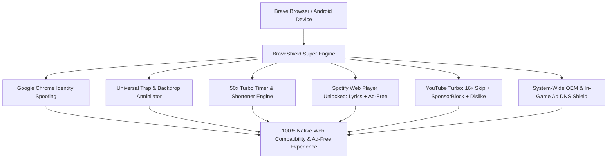

<div align="center">


# 🛡️ BraveShield Bypass Pro & Android Super Suite
### Universal Stealth, Anti-Detection, Spotify Unlocked & Turbo Automation Suite

[](https://github.com/Nikhil-Sonawane87612/braveshield-anti-detection-extension/releases/latest)
[](#-desktop-installation)
[](#-android-super-suite-setup)
[](#-the-core-stealth-modules)
[-06b6d4?style=for-the-badge&logo=safari&logoColor=white)](#-live-privacy-audit-score)

<p align="center">
  <b>The definitive stealth & ad-blocking engine for Desktop (PC/Mac) and Android devices.</b><br>
  Keep Brave Shields at maximum strength while appearing as pure Google Chrome. Enjoy ad-free Spotify with live synced lyrics, 16x YouTube fast-forwarding, 50x timer bypass, and system-wide in-app ad blocking.
</p>

[📥 Download Extension (.ZIP)](https://github.com/Nikhil-Sonawane87612/braveshield-anti-detection-extension/releases/latest) • [📱 Android Userscript (`.user.js`)](braveshield-android.user.js) • [🛡️ AdGuard Filters (`rules.txt`)](filters/rules.txt) • [📖 Android Guide](ANDROID-SETUP.md)

---

</div>

## 📖 About The Project

Modern websites, streaming platforms, and link shorteners deploy intrusive **anti-adblock traps**, **canvas/audio fingerprinting**, **Brave browser detectors**, and **artificial countdown gates**. When using Brave Browser with Shields enabled, sites detect internal indicators like `navigator.brave`, missing ad variables, or custom styling, then block access with popups, dimmed screens, or stalled timers.

**BraveShield Bypass Pro** is an enterprise-grade stealth suite that bridges ad-blocking with complete web invisibility:
- **On Desktop**: Seamless Manifest V3 extension featuring 42 active defense modules.
- **On Android**: Universal Userscript (`braveshield-android.user.js`) + System-Wide DNS Hostlist (`braveshield-dns-blocklist.txt`) that works in **normal mobile browsers** (AdGuard, Firefox Mobile, Samsung Internet) without requiring Kiwi or desktop-like browser setups.

---

## ✨ Key Features Overview



### ⚡ 1. Master Kill Switch (0ms Latency)
A global emergency toggle in popup and options headers to instantly pause or re-arm all modules, Declarative Net Request rules, and DOM hooks in real time.

### 🎭 2. Pure Google Chrome Emulation
- Completely purges `navigator.brave` and `isBrave()` from prototype chains.
- Spoofs Google Chrome Client Hints (`navigator.userAgentData.brands`), `window.chrome.app`, `window.chrome.runtime`, `csi`, and `loadTimes`.
- Strips Brave crypto wallet identifiers (`isMetaMask = true; isBraveWallet = false`).

### 🎵 3. Spotify Web Player Super Engine
- **Instant Audio Ad Mute & Skip**: Detects ad audio tracks, mutes them, and skips to the end in under 100ms.
- **🎤 Live Synced Karaoke Lyrics**: Automatically fetches real-time synced lyrics from `lrclib.net` API with a floating toggle.
- **⏭️ Unlimited Skips & Shuffles**: Re-enables disabled skip/shuffle buttons for free-tier users.
- **🛡️ Zero-Error Safe-List**: Preserves all audio streaming CDNs (`audio-fa.scdn.co`) and playlist APIs to guarantee **zero blank playlists or streaming errors**.
- **🔊 Mobile Audio Booster**: Built-in WebAudio Gain compressor allowing **100%–200% volume boost**.

### 🎬 4. YouTube Turbo Suite
- **16x Video Ad Fast-Forwarding**: Speeds through unskippable video ads in milliseconds with auto-mute.
- **👎 Return YouTube Dislike**: Real dislike count fetched via `returnyoutubedislikeapi.com` and injected next to the Like button.
- **🔒 Auto-Max 1080p/4K Quality Lock**: Locks video playback to highest available quality.
- **Universal Picture-in-Picture (PiP)** & Anti-Tab-Switch background playback.

### ⏩ 5. Turbo Timer & Shortener Fast-Pass (50x–100x Speedup)
- Compresses 15s–60s countdown loops into <0.3s while preserving security tokens.
- Safelink auto-clicker for WordPress Safelink, GPVadnagar (`#wpsafe-generate`, `#btn-main`, `.get-link`).
- Strictly excludes Blogger/WordPress pagination links (`reverse-paginate`) to eliminate infinite reload loops.

### 🛑 6. Mobile Protection & Usability
- **🛡️ Universal Consent & Disclaimer Fast-Pass**: Auto-preseeds compliance verification cookies/storage tokens and auto-confirms disclaimer gates while unhiding blocked media containers.
- **Android Back-Button Trap Neutralizer**: Suppresses malicious `history.pushState` redirect traps.
- **Anti-Vibration & Fake Alert Blocker**: Silences `navigator.vibrate` and fake virus warning dialogs.
- **⚡ Direct Media Stream Sniffer**: Auto-detects raw `.mp4`/`.m3u8` video streams with 1-tap VLC streaming.
- **📰 Paywall & Login-Wall Bypass**: Auto-unhides paywalled articles (Medium, Quora, Pinterest, news sites).

### 🎨 7. 10 Premium Visual Themes Gallery
| # | Theme Name | Background | Cards | Accent Gradient | Vibe |
| :-: | :--- | :--- | :--- | :--- | :--- |
| 🖤 1 | **Obsidian Noir** | `#0A0A0F` deep black | Glassmorphic `rgba(255,255,255,0.04)` | `#8B5CF6` → `#6366F1` | Dark luxury, premium stealth |
| 💜 2 | **Cyberpunk Neon** | `#0D0221` dark navy | Neon-bordered `rgba(0,255,136,0.06)` | `#00FF88` → `#00D4FF` | Futuristic hacker terminal |
| 🧊 3 | **Arctic Frost** | `#F0F4FF` icy white | Frosted glass `rgba(255,255,255,0.7)` | `#3B82F6` → `#06B6D4` | Clean, minimal, Apple-esque |
| 🌅 4 | **Sunset Gradient** | Animated gradient | Warm glass `rgba(255,107,53,0.08)` | `#F72585` → `#FF6B35` | Warm, energetic, vibrant |
| 🌊 5 | **Ocean Depth** | `#0B1628` deep sea | Aqua glass `rgba(6,182,212,0.06)` | `#06B6D4` → `#0EA5E9` | Calm, deep, mysterious |
| 🌿 6 | **Forest Emerald** | `#0A1F0A` dark forest | Leaf glass `rgba(16,185,129,0.06)` | `#10B981` → `#059669` | Natural, organic, fresh |
| 💜 7 | **Lavender Dream** | `#1A1025` soft plum | Lilac glass `rgba(167,139,250,0.08)` | `#A78BFA` → `#C084FC` | Soft, dreamy, premium |
| 🔥 8 | **Solar Flare** | `#1A0A00` ember black | Flame glass `rgba(249,115,22,0.06)` | `#F97316` → `#EAB308` | Bold, powerful, fiery |
| 🌌 9 | **Midnight Galaxy** | Animated starfield `#030014` | Cosmic glass `rgba(99,102,241,0.05)` | `#6366F1` → `#8B5CF6` | Space, cosmic, infinite |
| 🌹 10 | **Rose Gold** | `#1A0F0F` dark rose | Blush glass `rgba(244,114,182,0.06)` | `#F472B6` → `#FB923C` | Elegant, luxurious, refined |

---

## 📱 Android Super Suite Setup (Normal Browsers & System-Wide)

You do **not** need Kiwi Browser or a PC-like desktop browser to use BraveShield on Android! Here are the 3 best setups:

```
┌─────────────────────────────────────────────────────────────┐
│                    ANDROID DEVICE                           │
│                                                             │
│  Layer 1: Network & In-App Ads (System-Wide)                │
│  → Private DNS / AdGuard Filter                             │
│  → Blocks Spotify app ads, in-game ads, and OEM telemetry   │
│                                                             │
│  Layer 2: Browser & In-Page Engine                          │
│  → braveshield-android.user.js                              │
│  → Fast-forwards timers, destroys anti-adblock traps,       │
│    unlocks Spotify Web Player with synced lyrics & boost,   │
│    auto-skips YouTube sponsors, sniffs direct video streams  │
└─────────────────────────────────────────────────────────────┘
```

### 🚀 Setup A: AdGuard for Android (System-Wide + All Browsers)
1. Download & install **AdGuard for Android** from [adguard.com](https://adguard.com/en/adguard-android/overview.html).
2. **Prerequisite**: Ensure **HTTPS filtering** is enabled (*Protection 🛡️ → Ad blocking → HTTPS filtering*).
3. **Add Userscript**: Go to **Settings (⚙️)** → **Extensions** (or **Filtering → Extensions**) → Tap **Add extension (+)** → Choose **Import from URL** and paste the [`braveshield-android.user.js`](braveshield-android.user.js) link.
4. **Add DNS Blocklist**: In AdGuard → **Protection (🛡️)** → **DNS protection** → **DNS blocklists** → Import [`braveshield-dns-blocklist.txt`](braveshield-dns-blocklist.txt).
5. **Done!** Works automatically across Google Chrome, Brave Android, Samsung Internet, and background apps.

### 🦊 Setup B: Firefox Mobile / Mull Browser (100% Free)
1. Open **Firefox for Android** → Tap **Menu (⋮)** → **Add-ons**.
2. Install **Tampermonkey** or **Violentmonkey**.
3. Open Tampermonkey dashboard → Tap **+ Create a new script** → Paste the entire code from [`braveshield-android.user.js`](braveshield-android.user.js) → Save.
4. **Done!** Open Spotify (`open.spotify.com`), YouTube, or download links to experience instant fast-forwarding.

### 🌐 Setup C: Android Private DNS (Zero Battery, Zero VPN Icon)
1. Open Android **Settings** → **Network & Internet** → **Private DNS**.
2. Select **Private DNS provider hostname**.
3. Enter your NextDNS or Cloudflare Gateway endpoint (configured with [`braveshield-dns-blocklist.txt`](braveshield-dns-blocklist.txt)).
4. Tap **Save** — blocks in-app ads and OEM telemetry (Xiaomi, Samsung, Oppo) across your entire phone!

👉 *For detailed setup guides, check out the full [**ANDROID-SETUP.md**](ANDROID-SETUP.md) documentation.*

---

## 💻 Desktop Installation (Chrome / Brave / Edge / Opera)

1. Download the latest release from [**GitHub Releases**](https://github.com/Nikhil-Sonawane87612/braveshield-anti-detection-extension/releases/latest).
2. Extract the ZIP folder on your computer.
3. Open your browser and navigate to the extensions page:
   - **Brave**: `brave://extensions`
   - **Chrome**: `chrome://extensions`
   - **Edge**: `edge://extensions`
4. Toggle **Developer mode** ON (top-right corner).
5. Click **"Load unpacked"** and select the extracted folder.
6. 🎉 **All stealth modules are armed and active!**

---

## 🧩 The Core Stealth Modules

| # | Module Name | Category | Functionality |
| :-: | :--- | :--- | :--- |
| **01** | `Navigator.brave Purge` | Core Stealth | Removes `navigator.brave`, `isBrave()`, and cleans prototypes |
| **02** | `Client Hints Sanitizer` | Core Stealth | Spoofs Chrome 124–131 brand lists & platform metadata |
| **03** | `Ad Variable Bait Engine` | AdBlock Trap | Fakes `adsbygoogle`, `canRunAds`, `isAdBlockActive`, `ga`, `gtag` |
| **04** | `Modal & Backdrop Annihilator` | AdBlock Trap | Destroys anti-adblock modals, removes fullscreen dark overlays |
| **05** | `DOM Bait Dimension Trap Hook` | AdBlock Trap | Returns valid dimensions (`250x300`) for hidden ad-bait elements |
| **06** | `WebGL GPU Profile Spoofing` | Fingerprint | Emulates 14 realistic GPU profiles (RTX 4090, Apple M3 Max) |
| **07** | `Link Shortener Auto-Bypass` | Automation | Automated token resolution for 50+ shorteners (GPLinks, ouo.io) |
| **08** | `Countdown Timer Accelerator` | Automation | Compresses countdown loops (`setInterval`) to unlock downloads in <0.3s |
| **09** | `Click-Image-Wait Bypass` | Automation | Bypasses "Click ad banner and wait 15 seconds" download gates |
| **10** | `Cookie Consent Auto-Dismiss` | Usability | Automatically dismisses 28+ cookie consent banners |
| **11** | `Smart Auto-Scroll Trigger` | Automation | Simulates natural scrolling for scroll-gated links |
| **12** | `Redirect Chain Follower` | Automation | Instantly follows meta-refresh and client-side redirect chains |
| **13** | `Popunder Interceptor` | Anti-Malware | Blocks intrusive popunders while returning safe mock window handles |
| **14** | `Universal AdBlock Defeater` | AdBlock Trap | Defeats Admiral, BlockAdBlock, FuckAdBlock, and custom detection |
| **15** | `Synthetic Ad Network Responses` | Network | Intercepts ad-bait script network requests, returns 200 OK |
| **16** | `Spotify Ad Muter & Skipper` | Media Engine | Auto-mutes and skips Spotify audio ads in <100ms |
| **17** | `Spotify Synced Lyrics Engine` | Media Engine | Fetches and displays real-time synced lyrics from lrclib.net |
| **18** | `Spotify Unlimited Skips` | Media Engine | Unlocks forward skip and shuffle controls for free-tier users |
| **19** | `YouTube 16x Ad Fast-Forward` | Video Turbo | Accelerates video ads by 16x with auto-skip button trigger |
| **20** | `YouTube Return Dislike` | Video Turbo | Injects live dislike count via returnyoutubedislikeapi.com |
| **21** | `YouTube Auto-Max Quality` | Video Turbo | Forces 1080p60/4K video resolution |
| **22** | `Mobile Audio Booster 150%` | Audio Engine | WebAudio Gain + DynamicsCompressor volume booster |
| **23** | `Direct Media Stream Sniffer` | Media Engine | Auto-detects raw `.mp4`/`.m3u8` video streams for VLC playback |
| **24** | `Back-Button Trap Neutralizer` | Mobile Defense | Suppresses `history.pushState` redirect loops |
| **25** | `Anti-Vibration & Siren Blocker`| Mobile Defense | Silences `navigator.vibrate` and fake virus warning alerts |
| **26** | `Paywall & Login-Wall Bypass` | Web Usability | Unhides paywalled articles on Medium, Quora, news portals |
| **27** | `OEM Telemetry Killer (DNS)` | Network | Blocks Xiaomi, Samsung, Oppo, and Huawei tracking domains |
| **28** | `In-Game Ad SDK Blocker (DNS)` | Network | Blocks UnityAds, AppLovin, IronSource, and Vungle in mobile games |

---

## 🛠️ Project Structure

```
braveshield-anti-detection-extension/
├── manifest.json                 # Manifest V3 configuration (v5.1.0)
├── background.js                 # Service worker & DNR coordinator
├── content.js                    # Content script (ISOLATED realm)
├── inject.js                     # Desktop stealth engine (MAIN realm)
├── settings.js                   # Centralized module definitions & defaults
├── rules.json                    # Declarative Net Request rules
├── popup.html / .css / .js        # Glassmorphic Popup Dashboard
├── options.html / .css / .js      # Full-page Configuration Suite
├── theme.css                      # 10 Premium Visual Themes engine
├── icons/                        # High-res extension icons (16, 48, 128)
├── filters/
│   └── rules.txt                 # AdGuard / uBlock Origin formatted filter list
├── braveshield-android.user.js   # Universal Android Userscript (55+ features)
├── braveshield-dns-blocklist.txt # Curated System-Wide DNS Hostlist
├── ANDROID-SETUP.md              # Complete Android Setup & Deployment Guide
└── README.md                     # Main documentation
```

---

## 👤 Author & Contribution

Developed and maintained with ❤️ by **Nikhil Sonawane** ([@Nikhil-Sonawane87612](https://github.com/Nikhil-Sonawane87612)).

- 🐛 **Found a bug or bypass gap?** Open an [Issue](https://github.com/Nikhil-Sonawane87612/braveshield-anti-detection-extension/issues).
- 💡 **Have a feature idea?** Submit a [Pull Request](https://github.com/Nikhil-Sonawane87612/braveshield-anti-detection-extension/pulls).

---

## ⚖️ Disclaimer

*Disclaimer: This extension and userscript suite is intended for educational, privacy research, and personal web accessibility purposes. Please adhere to the terms of service of the websites you visit.*
