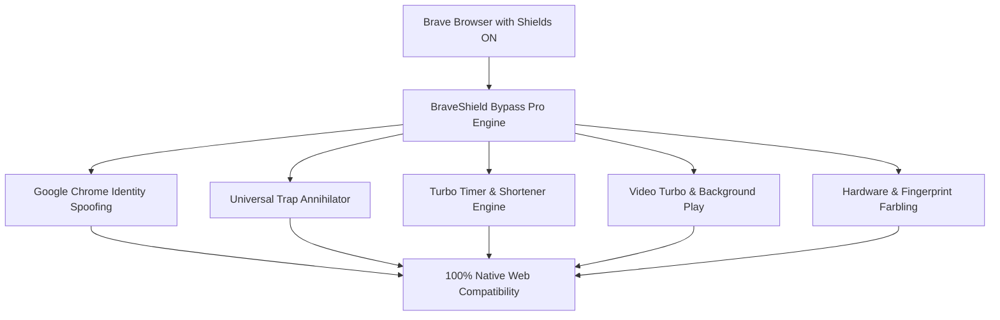

<div align="center">


# 🛡️ BraveShield Bypass Pro
### Universal Stealth, Anti-Detection & Turbo Automation Suite

[](https://github.com/Nikhil-Sonawane87612/braveshield-anti-detection-extension/releases/tag/v5.1.0)
[](#-installation)
[](#-the-42-stealth-modules)
[-06b6d4?style=for-the-badge&logo=safari&logoColor=white)](#-live-privacy-audit-score)
[](LICENSE)

<p align="center">
  <b>The definitive browser extension that bridges aggressive ad-blocking with total web invisibility.</b><br>
  Keep Brave Shields (or any ad-blocker) at maximum strength while appearing as genuine vanilla Google Chrome to every website.
</p>

[📥 Download Release (v5.1.0 ZIP)](https://github.com/Nikhil-Sonawane87612/braveshield-anti-detection-extension/releases/tag/v5.1.0) • [✨ Feature Overview](#-key-features) • [🧩 Module Directory](#-the-42-stealth-modules) • [🚀 Installation](#-installation)

---

</div>

## 📖 About The Project

Modern websites, video players, and download platforms increasingly deploy intrusive **anti-adblock traps**, **canvas/audio fingerprinting**, **Brave browser detectors**, and **artificial countdown gates**. When using Brave Browser with Shields enabled, sites detect internal indicators like `navigator.brave`, missing ad variables, or custom styling, then block access with popups, dimmed screens, or stalled timers.

**BraveShield Bypass Pro** is an enterprise-grade Manifest V3 stealth engine that seamlessly neutralizes all adblock traps, spoofs genuine Google Chrome client hints, fast-forwards countdown timers, annihilates modal overlays, and delivers unmatched privacy protection — allowing you to browse freely without disabling your ad-blocker.

---

## ✨ Key Features



### ⚡ 1. Master Kill Switch (0ms Latency)
A global emergency kill switch accessible directly from the popup HUD and settings page. Disables or re-arms all 42 modules, Declarative Net Request rules, and DOM hooks in real time without requiring browser restart.

### 🎭 2. Pure Google Chrome Emulation
- Completely purges `navigator.brave` and `isBrave()` from prototype chains.
- Spoofs Google Chrome Client Hints (`navigator.userAgentData.brands`), `window.chrome.app`, `window.chrome.runtime`, `csi`, and `loadTimes`.
- Strips Brave Solana and Ethereum crypto wallet identifiers (`isMetaMask = true; isBraveWallet = false`).

### ⏩ 3. Turbo Timer & Shortener Fast-Pass (Module 32)
- Accelerates standard 15s–60s countdown timers by **50x–100x** via paced `setInterval` / `setTimeout` compression.
- Safe handshake pacing guarantees background security tokens (e.g. `/links/go`) complete before link generation.
- Automatically unblocks safelink navigation and skips deceptive ad-click gates.

### 🎬 4. Video Turbo Engine (Module 28 & 31)
- **16x Video Ad Fast-Forwarding**: Speeds through unskippable video ads in milliseconds with auto-mute.
- **Defeat Tab-Switch Pause**: Keeps video players playing seamlessly when switching tabs or minimizing the browser.
- **Universal Picture-in-Picture (PiP)**: Force-enables PiP mode across any HTML5 video player.

### 🧹 5. Anti-Adblock Modal Annihilator & Backdrop Cleaner (Module 4)
- Destroys anti-adblock overlay modals (BlockAdBlock, FuckAdBlock, Admiral, Hispanoads).
- **Fullscreen Backdrop Sweeper**: Unconditionally clears dark overlays (`.sk-overlay`, `.modal-backdrop`, `.swal2-backdrop`) and restores 100% page opacity, brightness, and scrolling.

### 🛡️ 6. 1-Click Disposable Identity & Privacy Audit (Grade A+)
- **1-Click Identity Rotation**: Instantly rolls new random realistic User-Agent signatures + WebGL GPU profiles and flushes tracking storage with a single click.
- **Live Privacy Audit**: Real-time HUD showing defused traps, sanitized fingerprints, and current security score.

---

## 🧩 The 42 Stealth Modules

| # | Module Name | Category | Functionality |
| :-: | :--- | :--- | :--- |
| **01** | `Navigator.brave Purge` | Core Stealth | Removes `navigator.brave`, `isBrave()`, and cleans `Object.getOwnPropertyNames` |
| **02** | `Client Hints Sanitizer` | Core Stealth | Spoofs Chrome 124–131 brand lists & platform metadata in `userAgentData` |
| **03** | `Ad Variable Bait Engine` | AdBlock Trap | Fakes `adsbygoogle`, `canRunAds`, `isAdBlockActive`, `ga`, `gtag`, `pbjs` |
| **04** | `Modal & Backdrop Annihilator` | AdBlock Trap | Destroys anti-adblock modals, removes fullscreen dark overlays, restores scrolling |
| **05** | `DOM Bait Dimension Trap Hook` | AdBlock Trap | Returns valid dimensions (`250x300`) for hidden ad-bait elements (`offsetHeight`) |
| **06** | `WebGL GPU Profile Spoofing` | Fingerprint | Emulates 14 realistic GPU profiles (RTX 4090, Apple M3 Max, Iris Xe) |
| **07** | `Link Shortener Auto-Bypass` | Automation | Automated token resolution for 50+ shorteners (GPLinks, ouo.io, droplink) |
| **08** | `Countdown Timer Accelerator` | Automation | Compresses countdown loops (`setInterval`) to unlock downloads in < 0.3s |
| **09** | `Click-Image-Wait Bypass` | Automation | Bypasses "Click ad banner and wait 15 seconds" download barriers |
| **10** | `Cookie Consent Auto-Dismiss` | Usability | Automatically dismisses 28+ cookie consent banners (OneTrust, Cookiebot) |
| **11** | `Smart Auto-Scroll Trigger` | Automation | Simulates natural scrolling for pages that gate links behind scroll depth |
| **12** | `Redirect Chain Follower` | Automation | Instantly follows meta-refresh and client-side redirect chains |
| **13** | `Popunder Interceptor` | Anti-Malware | Blocks intrusive popunder windows while returning safe mock window handles |
| **14** | `Universal AdBlock Defeater` | AdBlock Trap | Defeats Admiral, BlockAdBlock, FuckAdBlock, and custom detection scripts |
| **15** | `Synthetic Ad Network Responses` | Network | Intercepts ad-bait script network requests and returns simulated 200 OK JS |
| **16** | `Brave Protocol Leak Defense` | Fingerprint | Strips internal `brave://` protocol leaks in anchor tag creation |
| **17** | `Storage Quota Normalizer` | Fingerprint | Reports consistent 2GB browser storage quota to prevent browser profiling |
| **18** | `AudioContext Fingerprint Shield`| Fingerprint | Injects subtle noise into `OfflineAudioContext` frequency analysis |
| **19** | `Canvas Noise Generator` | Fingerprint | Protects `toDataURL` and `getImageData` with imperceptible canvas noise |
| **20** | `Navigator.webdriver Cloak` | Bot Defense | Enforces `navigator.webdriver = false` to defeat automated bot flags |
| **21** | `WebRTC IP Leak Shield` | Privacy | Strips public STUN/TURN ICE servers to prevent real local IP exposure |
| **22** | `Sensory Permission Auto-Deny` | Privacy | Auto-denies camera, mic, accelerometer, and location query probes |
| **23** | `High-Precision Timer Clamp` | Timing Attack | Clamps `performance.now()` precision to defeat micro-architectural side-channels |
| **24** | `Navigator Consistency Engine` | Fingerprint | Enforces synchronized `hardwareConcurrency`, `platform`, and language lists |
| **25** | `CSS Variable Leak Cleaner` | CSS Defense | Purges browser-injected custom properties (`--brave-*`) from the DOM |
| **26** | `Font Enumeration Cloaking` | Fingerprint | Spoofs `document.fonts.check()` to normalize system font availability |
| **27** | `Viewport & Screen Parity` | Fingerprint | Synchronizes `window.screen` and viewport geometry with spoofed profile |
| **28** | `YouTube Ad Fast-Forwarder` | Video Turbo | 16x video ad acceleration, auto-skip, player overlay removal on YouTube |
| **29** | `YouTube SponsorBlock` | Video Turbo | Fetches sponsor segments from SponsorBlock API and automatically skips them |
| **30** | `Undetectable DevMode` | Developer | Neutralizes `debugger` traps, CSP restrictions, and right-click inspectors |
| **31** | `Universal Video Turbo Engine` | Video Turbo | Universal 16x ad skipper, anti-tab-switch pause defeat, force Picture-in-Picture |
| **32** | `Turbo Timer & Shortener Fast-Pass`| Automation | 50x countdown pacing, safelink unblocker, premature click prevention |
| **33** | `Global Privacy Control Mask` | Privacy | Hides `navigator.globalPrivacyControl` signal to prevent adblock fingerprinting |
| **34** | `Right-Click & Selection Enforcer`| Usability | Strips `contextmenu` and `selectstart` blockers to restore text selection |
| **35** | `Notification Spam Suppressor` | Usability | Automatically rejects intrusive web push notification prompts |
| **36** | `Clipboard Read Protector` | Security | Blocks malicious background scripts from silently inspecting your clipboard |
| **37** | `Device Memory Normalizer` | Fingerprint | Reports standard RAM values (`8GB` / `16GB`) to eliminate hardware profiling |
| **38** | `Battery Status API Neutralizer`| Fingerprint | Spoofs standard charging level to prevent battery fingerprinting |
| **39** | `Timezone & Geolocation Spoof` | Fingerprint | Aligns JavaScript `Intl.DateTimeFormat` timezone with selected locale |
| **40** | `Network Header Synchronizer` | Network | Synchronizes `Accept-Language`, `Sec-CH-UA`, and `User-Agent` headers |
| **41** | `Declarative Net Request Engine`| Network | High-performance MV3 network rule engine defusing 100+ ad-tracker vectors |
| **42** | `AI Sites Safe-List Guard` | Compatibility | Automatically exempts ChatGPT, Claude, Gemini, DeepSeek, and Perplexity |

---

## 🚀 Installation

### Option A: Install from GitHub Release (Recommended)
1. Download the latest release package: [**BraveShield-Bypass-Pro-v5.1.0.zip**](https://github.com/Nikhil-Sonawane87612/braveshield-anti-detection-extension/releases/tag/v5.1.0).
2. Extract the ZIP folder to your desired directory.
3. Open your browser and navigate to the extensions page:
   - **Brave**: `brave://extensions`
   - **Chrome**: `chrome://extensions`
   - **Edge**: `edge://extensions`
4. Toggle **Developer mode** on (top-right switch).
5. Click **"Load unpacked"** and select the extracted folder (the directory containing `manifest.json`).
6. 🎉 **All 42 stealth modules are armed and active!**

---

## 🖥️ User Interface Preview

### Obsidian Glassmorphic Popup UI
- **Master Kill Switch**: Instant 1-click global extension toggle.
- **Telemetry HUD**: Live Privacy Grade (A+ / 100%), Traps Defused counter, and Sites Bypassed metrics.
- **Module Control Grid**: Categorized accordions with instant search and toggle-all capabilities.
- **Identity Switcher**: 1-click profile randomizer with instant storage purge.

---

## 🛠️ Project Structure

```
braveshield-anti-detection-extension/
├── manifest.json            # Manifest V3 configuration (v5.1.0)
├── background.js            # Background service worker & DNR coordinator
├── content.js               # Content script (ISOLATED execution realm)
├── inject.js                # Core stealth engine (MAIN execution realm)
├── settings.js              # Centralized module definitions & defaults
├── rules.json               # Declarative Net Request network rulesets
├── popup.html / .css / .js   # Glassmorphic Popup Dashboard
├── options.html / .css / .js # Full-page Configuration Suite
├── icons/                   # High-res extension icons (16x16, 48x48, 128x128)
└── README.md                # Comprehensive documentation
```

---

## 👤 Author & Contribution

Developed and maintained with ❤️ by **Nikhil Sonawane** ([@Nikhil-Sonawane87612](https://github.com/Nikhil-Sonawane87612)).

- 🐛 **Found a bug or bypass gap?** Open an [Issue](https://github.com/Nikhil-Sonawane87612/braveshield-anti-detection-extension/issues).
- 💡 **Have a feature idea?** Submit a [Pull Request](https://github.com/Nikhil-Sonawane87612/braveshield-anti-detection-extension/pulls).

---

## ⚖️ License & Disclaimer

This project is licensed under the **MIT License** — see the [LICENSE](LICENSE) file for details.

*Disclaimer: This extension is intended for educational, privacy research, and personal web accessibility purposes. Please adhere to the terms of service of the websites you visit.*
