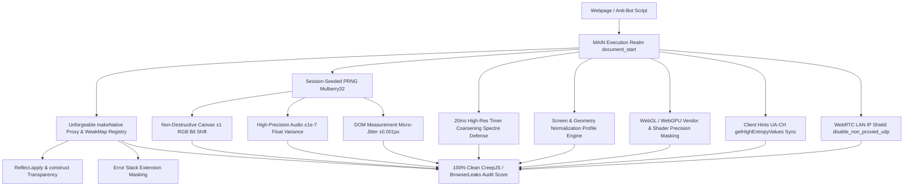

<div align="center">


# 🛡️ BraveShield Bypass Pro — Enterprise Anti-Fingerprinting Suite
### Manifest V3 Stealth Engine • CreepJS & BrowserLeaks Evasion • Multi-Device Hardware Spoofer

[](https://github.com/Nikhil-Sonawane87612/braveshield-anti-detection-extension/releases/latest)
[](#-desktop-installation)
[](#-the-creepjs--browserleaks-evasion-pack)
[](#-multi-device-hardware-studio)
[](#-live-privacy-audit-score)

<p align="center">
  <b>The enterprise-grade anti-fingerprinting and stealth engine compliant with Manifest V3.</b><br>
  Neutralize CreepJS, BrowserLeaks, and anti-bot heuristic detectors. Run with maximum Brave Shields strength while presenting a 100% authentic Google Chrome hardware profile, session-seeded canvas/audio mathematical noise, 20ms timer coarsening, WebRTC IP shielding, and unshortening automation.
</p>

[📥 Download Extension (.ZIP)](https://github.com/Nikhil-Sonawane87612/braveshield-anti-detection-extension/releases/latest) • [📱 Android Userscript (`.user.js`)](braveshield-android.user.js) • [🛡️ AdGuard Filters (`rules.txt`)](filters/rules.txt) • [📖 Architecture Docs](memory/architecture.md)

---

</div>

## 📖 About The Project

Modern websites, streaming platforms, and bot-detection engines (Cloudflare, DataDome, Akamai, PerimeterX, CreepJS) utilize sophisticated fingerprinting heuristics:
1. **Prototype Inspection & Lie Detection**: Testing whether native methods have been wrapped or proxied via `Function.prototype.toString`, `Reflect.apply`, or invalid receiver invocations.
2. **Error Stack Analysis**: Checking `Error.prototype.stack` to uncover internal `chrome-extension://` or script URLs.
3. **Canvas & Audio Fingerprinting**: Rendering hidden 2D/WebGL scenes and synthesizing audio signals to compute cross-origin hardware hashes.
4. **Side-Channel Timing Probes**: Running sub-millisecond `performance.now()` loops to benchmark CPU caches (Spectre).
5. **Client Hints Mismatches**: Checking discrepancies between `navigator.userAgent` and `navigator.userAgentData.getHighEntropyValues()`.
6. **WebRTC Private IP Leaks**: Probing STUN/TURN servers to discover internal LAN IPs behind VPNs.

**BraveShield Bypass Pro v6.0.0** solves this comprehensively by injecting an unforgeable, mathematically robust stealth layer directly at `document_start` in the `MAIN` execution world.

---

## ✨ Architectural Highlights (v6.0.0)



---

## 🛡️ Core Stealth & Anti-Fingerprinting Pillars

### 1. Unforgeable Native Function Proxies (`makeNative`)
- Wraps overridden prototypes with `WeakMap`-backed tracking.
- `Function.prototype.toString.call(fn)` returns genuine `function [name]() { [native code] }`.
- `toString.toString()` returns `function toString() { [native code] }`.
- Transparent `Reflect.apply` and `Reflect.construct` forwarding ensures deep JavaScript reflection validation passes with zero illegal invocation errors.
- Sanitizes `Error.prototype.stack` and `Error.captureStackTrace` to strip internal extension URLs.

### 2. Session-Seeded Mathematical Noise (Non-Destructive)
- **Canvas Noise**: Injects non-destructive `±1` RGB sub-pixel bit shifts into `HTMLCanvasElement.prototype.toDataURL`, `toBlob`, and `CanvasRenderingContext2D.prototype.getImageData`. Human-visible images and CAPTCHAs render with zero flaws while cross-session hashes differ.
- **Audio Stack Variance**: Injects sub-audible `±1e-7` statistical float variance into `AnalyserNode`, `AudioBuffer`, and `OfflineAudioContext`.

### 3. Screen, Font, & Geometry Normalization
- **DOM Rect Micro-Jitter**: Injects `±0.001px` deterministic sub-pixel noise into `Element.prototype.getBoundingClientRect` to defeat font measurement tracking.
- **Screen Masking**: Standardizes `window.screen` (`width`, `height`, `availWidth`, `availHeight`, `colorDepth`, `pixelDepth`), `window.devicePixelRatio`, `outerWidth`, and `outerHeight` to match the selected active hardware profile.

### 4. High-Resolution Timing & Side-Channel Defense
- Clamps `performance.now()`, `Date.now()`, and `Event.prototype.timeStamp` to **20ms coarsened resolution**, destroying CPU cache benchmarking and Spectre timing probes.

### 5. WebGL, WebGPU, & Client Hints (UA-CH) Parity
- Masks `UNMASKED_VENDOR_WEBGL` (`0x9245`), `UNMASKED_RENDERER_WEBGL` (`0x9246`), `VENDOR`, `RENDERER`, `WEBGL_debug_renderer_info`, and `getShaderPrecisionFormat`.
- Fully synchronizes `navigator.userAgentData.brands`, `platform`, and `getHighEntropyValues(['architecture', 'bitness', 'model', 'platform', 'platformVersion', 'fullVersionList', 'wow64'])`.

### 6. WebRTC Deep Shield & Media Sanitization
- Enforces `chrome.privacy.network.webRTCIPHandlingPolicy` (`disable_non_proxied_udp`) in service worker.
- Filters private LAN candidates (`192.168.x.x`, `10.x.x.x`, `172.16.x.x`, `.local`) in SDP offers and answers.
- Standardizes virtual hardware arrays on `navigator.mediaDevices.enumerateDevices()` and voices on `speechSynthesis.getVoices()`.

### 7. DeclarativeNetRequest Tracking Query Parameter Stripper
- Automatically strips `utm_*`, `fbclid`, `gclid`, `mc_eid`, `igshid`, `msclkid`, and `yclid` query parameters via high-performance DNR rules.

---

## 🎛️ Multi-Device Hardware Studio (110+ Presets)

The Options Studio features over 110 real-world device profiles and a custom hardware builder:
- **NVIDIA GeForce Series**: RTX 4090, RTX 4080, RTX 3080, RTX 3060.
- **AMD Radeon Series**: RX 7900 XTX, RX 6800 XT, Radeon RX 580.
- **Apple Silicon Series**: Apple M3 Max, Apple M2 Pro, Apple M1 Ultra.
- **Intel Arc & Iris Series**: Intel Arc A770, Intel Iris Xe Graphics.
- **Custom Hardware Builder**: Configure custom Platform, CPU Concurrency, RAM, Screen Resolution, DPR, and GPU strings with JSON backup export/import.

---

## 💻 Desktop Installation (Chrome / Brave / Edge / Opera)

### Option A — Release ZIP (recommended)
1. Download **`BraveShield-vX.Y.Z.zip`** from the [**Releases page**](https://github.com/Nikhil-Sonawane87612/braveshield-anti-detection-extension/releases).
2. Extract it — all extension files sit at the **root** of the extracted folder (`manifest.json` is immediately visible).
3. Open your browser's extensions page:
   - **Brave**: `brave://extensions`
   - **Chrome**: `chrome://extensions`
   - **Edge**: `edge://extensions`
4. Toggle **Developer mode** ON (top-right corner).
5. Click **"Load unpacked"** and select the **extracted folder itself** (the one containing `manifest.json`).
6. 🎉 **All stealth modules are armed and active!**

> Build your own ZIP any time with one command: `powershell -File build.ps1` → outputs `dist/BraveShield-v<version>.zip`.

### ⚠️ Import Troubleshooting
| Error | Cause | Fix |
|-------|-------|-----|
| *"Manifest file is missing or not accessible"* | Selected the wrong folder level, or used GitHub's **"Source code (ZIP)"** which nests everything inside `braveshield-anti-detection-extension-main/` | Select the folder that **directly contains** `manifest.json`. Prefer release ZIPs built by `build.ps1` |
| *Icon/ruleset load errors* | Partial extraction or moved files after loading | Re-extract fully and re-load |
| *Toggles don't seem to apply* | Extension was updated while pages were open | Reload the page once — after that every toggle applies live, no reloads needed |

### Option B — Clone for development
```bash
git clone https://github.com/Nikhil-Sonawane87612/braveshield-anti-detection-extension.git
# then chrome://extensions -> Developer mode -> Load unpacked -> select repo root
```

---

## 📂 Project Architecture

```
braveshield-anti-detection-extension/
├── manifest.json                 # Manifest V3 configuration
├── background.js                 # Service worker: defaults, WebRTC policy, update checker
├── content.js                    # ISOLATED world: LIVE config bridge (instant toggles) + HUD + DOM defense
├── inject.js                     # MAIN world stealth engine — hooks consult live BS_CONFIG at call-time
├── shared/constants.js           # Shared hosts/params/helpers loaded in BOTH worlds + pages
├── hardware-profiles.js          # Catalog of 110+ authentic hardware presets (MAIN world)
├── useragents.js                 # UA database used to resolve per-profile User-Agents
├── build.ps1                     # Release packager -> root-level load-ready ZIP
├── rules.json                    # Declarative Net Request tracking parameter rules
├── popup.html / .css / .js        # Glassmorphic Popup Dashboard with honest live counters
├── options.html / .css / .js      # Full-page Hardware Studio & Custom Builder
├── memory/                       # Obsidian-compatible Context & Architecture Vault
│   ├── INDEX.md                  # Vault index and navigation
│   ├── project_state.md          # Active state, backlog, and release target
│   ├── architecture.md           # Low-level technical specifications
│   ├── decision_log.md           # Architectural Decision Records (ADRs)
│   ├── changelog.md              # Semantic Versioning release notes
│   └── test_matrix.md            # CreepJS & BrowserLeaks verification tests
├── icons/                        # High-res extension icons (16, 48, 128)
└── README.md                     # Main documentation
```

---

## 👤 Author & Contribution

Developed and maintained with ❤️ by **Nikhil Sonawane** ([@Nikhil-Sonawane87612](https://github.com/Nikhil-Sonawane87612)).

- 🐛 **Found a bug or bypass gap?** Open an [Issue](https://github.com/Nikhil-Sonawane87612/braveshield-anti-detection-extension/issues).
- 💡 **Have a feature idea?** Submit a [Pull Request](https://github.com/Nikhil-Sonawane87612/braveshield-anti-detection-extension/pulls).

---

## ⚖️ Disclaimer

*Disclaimer: This extension and userscript suite is intended for educational, privacy research, and personal web accessibility purposes. Please adhere to the terms of service of the websites you visit.*
